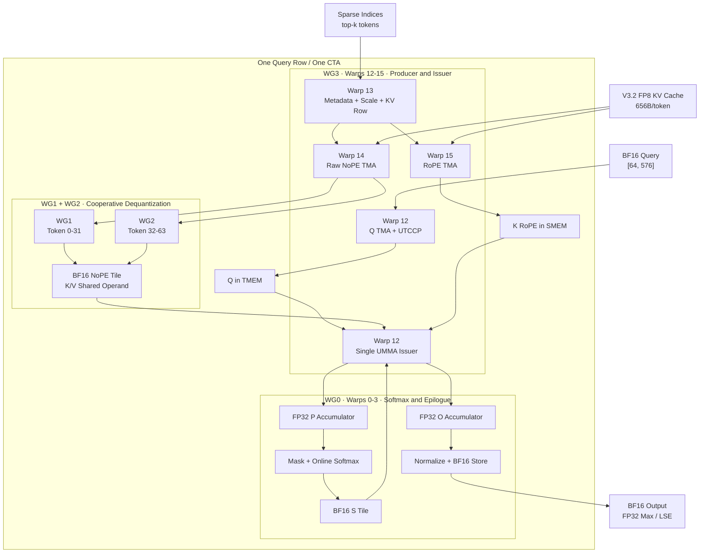
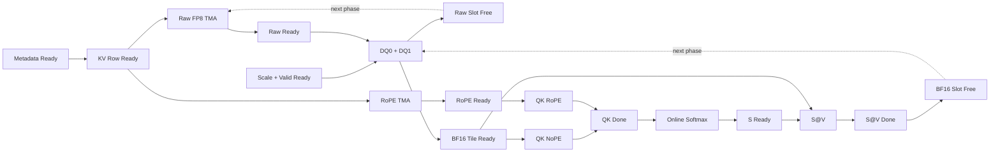

# DeepSeek V3.2 Native FP8 Sparse Prefill Kernel 技术报告

## 1. 项目背景与设计目标

DeepSeek V3.2 的 sparse prefill 为每条 Query 读取 top-k KV token。v8 让 FlashMLA 直接消费 V3.2 FP8 KV cache，并在一个 fused kernel 内完成 dequantization、QK、online softmax 与 S@V。 **v8是只第八个尝试的idea**


| 特点                              | v8        |
| --------------------------------- | --------- |
| FP8 KV cache 的直接输入           | 支持      |
| Global BF16 dequant workspace     | 不使用    |
| CTA-local BF16 shared-memory tile | 使用      |
| Q 的 FP8 requantization           | 不使用    |
| QK 与 S@V 的 tensor-core 类型     | BF16 UMMA |
| FP32 scale 的格式转换             | 不使用    |

## 2. FP8 Decode-as-Prefill 路径

现有 FlashMLA 将多条 Query reshape 为 decode 格式，再调用 native FP8 sparse-decode kernel。

```text
[BS × new, H, D]
  -> [BS × new, 1, H, D]
  -> sparse FP8 decode
```

该路径是 v8 的主要性能基线，但有两个限制：

1. Decode metadata 的 dynamic-SMEM 用量随 folded row 数增长。B16/B32 在 B200/B300 上会超过约 227KiB 的 shared-memory 上限。
2. Decode kernel 会将 FP32 `float4` scale 转换为 E8M0，不能作为 v8 的数值 reference。

## 3. 输入输出与数值契约

### 3.1 Tensor 契约

| Tensor          | Shape                               | Dtype                          |
| --------------- | ----------------------------------- | ------------------------------ |
| Query           | `[s_q, H, 576]`                   | BF16                           |
| KV cache        | `[num_blocks, page_size, 1, 656]` | byte-addressable FP8 container |
| Sparse indices  | `[s_q, 1, topk]`                  | INT32                          |
| `topk_length` | `[s_q]`, optional                 | INT32                          |
| `attn_sink`   | `[H]`, optional                   | FP32                           |
| Output          | `[s_q, H, 512]`                   | BF16                           |
| Max logits      | `[s_q, H]`                        | FP32                           |
| LSE             | `[s_q, H]`                        | FP32                           |

其中：

```text
H      ∈ {64, 128}
d_qk   = 576 = 512 NoPE + 64 RoPE
d_v    = 512
h_kv   = 1
topk   > 0, topk % 64 == 0
```

### 3.2 V3.2 Token Layout

每个 KV token 占用 656B：

|    Byte offset | 内容                    | 数据类型    |           大小 |
| -------------: | ----------------------- | ----------- | -------------: |
|         0～511 | NoPE payload            | 512 × E4M3 |           512B |
|       512～527 | Group scale             | 4 × FP32   |            16B |
|       528～655 | RoPE payload            | 64 × BF16  |           128B |
| **合计** | **V3.2 KV token** |             | **656B** |

Block stride 必须是 656B 的整数倍，且不小于 `page_size × 656`。Kernel 直接使用输入 tensor 的 block stride，因此支持 padded multi-block cache 与带 padding 的 single-block cache。

### 3.3 Exact FP32 Scale 契约

V3.2 对前 512 个 NoPE channel 采用 `1 × 128` 的分组量化。每个 token 保存四个 FP32 scale，每个 scale 对应 128 个 channel。

```text
group = d / 128

K_bf16[token, d] = BF16_RN(
    FP32(K_e4m3[token, d]) × scale_fp32[token, group]
)
```

v8 保留以下数值语义：

- 任意 FP32 scale 保持原始数值
- 每个 128-channel group 使用独立 scale
- Invalid/OOB token materialize 为 BF16 zero
- BF16 Query 不执行额外 FP8 quantization
- `topk_length` 之外的 index 不参与 attention
- Duplicate index 保持输入语义，不执行隐式去重

### 3.4 数值 Reference 与性能 Target

Correctness 由独立的 V3.2 dequantization 与 BF16 sparse-attention reference 判定。FP8 decode-as-prefill 只用于性能对比。

## 4. v8 核心设计

Sparse KV access 与 FP8 dequantization 必须跟上 BF16 UMMA 的执行速度。v8 为每条 Query row 启动一个 CTA，并将 metadata、TMA、dequantization、UMMA 与 online softmax 分配给不同的 warpgroup。

| 设计点                         | 实现                                           |
| ------------------------------ | ---------------------------------------------- |
| Selected-token materialization | 只转换 top-k 选中的 KV token                   |
| Cooperative dequantization     | 两个 warpgroup 各处理 32 个 token              |
| K/V tile reuse                 | 同一 BF16 NoPE tile 同时用于 QK 与 S@V         |
| RoPE 搬运                      | Elected-lane TMA gather4，直接写入 SW64 layout |
| Rowwise scratch                | 复用已消费的 P exchange word                   |
| P peer reduction               | One-ahead`float4` load pipeline              |
| Memory planning                | Shared-memory lifetime aliasing                |

#### Pair-local Scratch Alias

v8 不分配独立的 512B `rowwise_scratch[128]`，而是复用已经完成 peer P read 的 `p_exchange_buf` word：

```text
scratch_column(lane) = 4 × lane + floor(lane / 8)
```

该映射满足三项要求：

1. 32 个 lane 的 scratch 地址互不重叠
2. 每个 lane 只写入自己已经消费的 `float4` word
3. `scratch_column mod 32` 构成 0～31 的排列，每个 shared-memory bank 只访问一次

连续 scratch 地址会与 peer `float4` read 发生 cross-lane race。上述映射不需要额外的 `__syncwarp()`，并通过了 racecheck。

#### SW64 RoPE TMA Gather

独立的 `tensor_map_rope` 驱动 TMA gather4，并直接生成 UMMA 所需的 SW64 layout。

```text
每个 tile:
64 tokens × 64 BF16
= 16 row groups × 2 half-row parts
= 32 次 gather4
```

RoPE payload 的字节数不变；TMA 减少了普通 LSU request 与 shared-memory wavefront。

#### One-ahead P Peer-load Pipeline

WG0 从 peer warp 的 exchange buffer 读取 `float4`。下一次 shared load 会在当前两个 `float2` add 之前发出。

```text
load peer chunk i+1
-> accumulate peer chunk i
-> advance register pipeline
```

One-ahead 隐藏部分 shared-load scoreboard latency。Two-ahead 延长 register live range，性能反而下降。

## 5. CTA 设计

下图给出单个 CTA 的 dataflow 与 warpgroup 分工：



### 5.1 Grid 与 Tile 结构

H64 kernel 为每条 flattened Query row 启动一个 CTA。

```text
grid.x                  = s_q
CTA / Query row         = 1
threads / CTA           = 512
warps / CTA             = 16
warpgroups / CTA        = 4
Query heads / core      = 64
KV tokens / tile        = 64
```

Top-k 为 2,048 时，每个 CTA 处理 32 个 KV tile：

```text
2048 / 64 = 32 KV tiles
```

Batch Size 只改变 CTA 数量。例如 `B=4`、`new=875` 时，`s_q=3,500`，同一 kernel 启动 3,500 个 CTA。

### 5.2 Warpgroup 职责

| Warpgroup |  Warps | 核心职责                                                         |
| --------- | -----: | ---------------------------------------------------------------- |
| WG0       |   0～3 | P reduction、mask、online softmax、S generation、output epilogue |
| WG1       |   4～7 | DQ0：token 0～31 的 FP8->BF16 conversion                         |
| WG2       |  8～11 | DQ1：token 32～63 的 FP8->BF16 conversion                        |
| WG3       | 12～15 | Q/UMMA issuer、metadata、raw FP8 TMA、RoPE TMA                   |

WG3 内部的职责如下：

| Warp | 核心职责                                         |
| ---: | ------------------------------------------------ |
|   12 | Q->TMEM、QK/S@V 的唯一 UMMA issuer               |
|   13 | Index、valid mask、KV row coordinate、FP32 scale |
|   14 | 512B/token NoPE raw FP8 TMA gather               |
|   15 | 128B/token RoPE BF16 TMA gather                  |

Warp 12 只有一个 elected lane 发出 UMMA instruction。单 issuer 保证 QK 与 S@V 的执行顺序，无需额外的 cross-warp ordering。

## 6. Query 常驻路径

每个 CTA 持有一个 H64 Query tile：

```text
[64 heads, 576]
= [64 heads, 512 NoPE + 64 RoPE]
```

CTA 启动阶段只搬运一次 Query。

```text
Global Q
  ├─ TMA -> Shared Q NoPE
  └─ TMA -> Shared Q RoPE

Shared Q
  └─ UTCCP -> TMEM
       ├─ Q columns      : 256..383
       └─ Q_ROPE columns : 384..399
```

Query 被全部 top-k tile 复用。Q 完成 UTCCP 后，mainloop 不再读取 global Q，其 shared-memory 区域也可以复用。

## 7. Metadata 与 KV 地址计算

Warp 13 的每个 lane 处理两个 sparse index：

```text
读取 sparse index
-> 检查 topk_length
-> 检查 negative/OOB index
-> 计算 page 与 page-local offset
-> 计算 KV row coordinate
-> 读取四个 FP32 scale
-> 生成 valid bit
```

KV row coordinate 保存在 2-slot ring 中：

```text
tma_coord[0][64]
tma_coord[1][64]
```

FP32 scale 使用单 stage storage：

```text
scales[64][4]
```

等待当前 scale/valid stage 释放时，metadata warp 会将下一 tile 的 index、row coordinate 与 scale 预取到 register。Row coordinate 使用独立的 double buffer，因此下一 tile 的 raw/RoPE TMA 可以提前发出。

## 8. Raw FP8 与 RoPE 数据加载

### 8.1 Raw NoPE TMA 路径

`raw` 表示尚未乘 FP32 scale、尚未转换为 BF16 的 E4M3 byte payload。`raw_nope` 是 shared-memory staging buffer，不是最终的 K/V operand。

Warp 14 将 64 个 token 的 NoPE payload 加载到当前 raw slot。

```text
64 tokens × 512B
-> raw_nope[slot]
```

每次 TMA gather4 加载四个 token，每个 tile 共发出 16 次。

Raw buffer 使用 row-major layout，只作为 TMA destination 与 dequant source。UMMA 使用转换后的 SW128 BF16 tile。

### 8.2 RoPE TMA 路径

Warp 15 使用相同的 KV row coordinate，将 64 个 token 的 RoPE payload 直接加载到 SW64 layout。

```text
64 tokens × 64 BF16
-> k_rope shared-memory tile
```

每次 gather4 加载四个 token 的 32 个 BF16 channel。64 个 RoPE channel 分成两个 half-row part，每个 tile 共发出 32 次。

Raw NoPE 与 RoPE 由两个 warp 独立推进。两者共享 row-coordinate ring，但使用不同的 transaction barrier。

## 9. Cooperative Dequantization

WG1 与 WG2 共同处理一个 64-token tile：

```text
WG1 / DQ0 : token  0..31
WG2 / DQ1 : token 32..63
```

每个 warpgroup 包含 16 个 8-thread subgroup，每个 subgroup 处理两个 token。

单个 token 的转换：

```text
FP8 NoPE[512]
+ FP32 scale[4]
-> BF16 NoPE[512]
```

Channel 与 scale 的映射：

```text
channels   0..127 × scale[0]
channels 128..255 × scale[1]
channels 256..383 × scale[2]
channels 384..511 × scale[3]
```

转换后的 BF16 tile 同时用作 K 与 V：

```text
QK operand K : [64 tokens, 512 NoPE]
S@V operand V: [64 tokens, 512 value]
```

由于 `D_NOPE == D_V == 512`，QK 与 S@V 可以复用同一份 BF16 materialization。

## 10. QK、Online Softmax 与 S@V 流水线

### 10.1 QK 分解

QK 分成 RoPE 与 NoPE 两部分，并累加到同一个 FP32 TMEM P accumulator：

```text
P(k) = Q_RoPE × K_RoPE(k)
     + Q_NoPE × K_NoPE(k)
```

### 10.2 UMMA Issue 顺序

Steady-state issuer 顺序：

```text
QK_RoPE(k)
-> S@V(k-1)
-> wait BF16 tile(k)
-> QK_NoPE(k)
-> publish QK completion(k)
```

QK 与 S@V 共享一个 elected issuer，按上述顺序 interleave。Metadata、TMA 与 dequant warpgroups 同时准备后续数据。

### 10.3 Pipeline Prologue 与 Epilogue

```text
Prologue:
  QK(0)
  QK(1) -> S@V(0)

Steady state:
  QK_RoPE(k) -> S@V(k-1) -> QK_NoPE(k)

Epilogue:
  final QK completion -> final S@V -> output normalization
```

S@V 累加到 FP32 TMEM O accumulator。全部 tile 完成后，WG0 使用 online-softmax state 归一化 O，并写回 BF16 output。

## 11. Online Softmax 结构

Kernel 不保存完整的 2,048 个 logits。每个 64-token tile 在 CTA 内更新 running max 与 running sum：

```text
读取 P tile
-> invalid-token mask
-> tile max reduction
-> running max merge
-> exp 与 tile sum
-> BF16 S tile generation
-> conditional O rescale
```

WG0 的四个 warp 组成两个 peer pair：

```text
warp 0 <-> warp 2
warp 1 <-> warp 3
```

每个 pair 通过 `p_exchange_buf` 合并 partial P、max 与 sum。Pair-local scratch 复用同一 buffer。

Online softmax 使用 lazy O-rescale。只有 running max 的变化超过阈值时，才 rescale TMEM O accumulator。

## 12. Barrier 与 Buffer 生命周期

下图给出一个 KV slot 从写入到复用的依赖关系：



### 12.1 2-slot Phase 协议

KV storage 使用两个 slot 交替工作：

```text
slot  = tile_index & 1
phase = (tile_index >> 1) & 1
```

示例：

```text
tile 0 -> slot 0, phase 0
tile 1 -> slot 1, phase 0
tile 2 -> slot 0, phase 1
tile 3 -> slot 1, phase 1
```

Slot index 与 phase bit 共同区分不同 tile，支持 top-k 4,096 的 64-tile phase wrap。

### 12.2 依赖关系

```text
metadata
  -> KV row ready
  -> raw/RoPE TMA issue

raw + scale + valid ready
  -> cooperative dequantization

DQ completion
  -> BF16 ready
  -> QK NoPE issue

WG0 softmax completion
  -> S ready
  -> S@V issue

S@V completion
  -> BF16 V slot reuse
```

两个 DQ warpgroup 读完后即可复用 raw slot。BF16 slot 必须等待 S@V 完成，因为同一 tile 同时用作 K 与 V。

Barrier 负责以下同步：

- TMA transaction completion
- Producer/consumer ordering
- Raw、BF16、row-coordinate、scale 与 S storage 的复用边界
- Slot phase wrap 的代际区分
- Metadata lookahead 与当前 tile consumption 的解耦

## 13. Shared Memory 与 TMEM 规划

### 13.1 Shared-memory Alias

v8 使用 231,168B dynamic shared memory。生命周期不重叠的数据共享以下区域：

```text
Q NoPE storage
  <-> K NoPE BF16 slot region

Q RoPE storage
  <-> S storage

K/Q main storage
  <-> output epilogue staging
```

复用顺序：

```text
Q Global->Shared->TMEM completion
-> Q shared storage 复用为 K BF16 tile

Q RoPE Shared->TMEM completion
-> Q RoPE storage 复用为 S tile

全部 QK/S@V completion
-> main storage 复用为 output staging
```

### 13.2 TMEM Column 规划

```text
O accumulator : columns   0..255
Q NoPE        : columns 256..383
Q RoPE        : columns 384..399
P accumulator : columns 400..463
```

Q 在 CTA 启动阶段写入 TMEM。P 保存当前 QK logits，O 保存跨 tile 的 FP32 accumulation。

### 13.3 Resource 预算

| Resource                  | Production v8 |
| ------------------------- | ------------: |
| Threads / CTA             |           512 |
| Warps / CTA               |            16 |
| Warpgroups / CTA          |             4 |
| Registers / thread        |           128 |
| Barriers                  |            16 |
| Dynamic SMEM              |      231,168B |
| Stack frame               |            0B |
| Spill stores / loads      |       0B / 0B |
| Theoretical occupancy     |           25% |
| Measured active occupancy |        23.85% |

Shared-memory footprint 将 residency 限制为每个 SM 一个 CTA。Latency hiding 依赖 CTA 内的 metadata、TMA、dequantization、UMMA 与 softmax pipeline。

## 14. H128 支持

### 14.1 两次 H64 Launch 处理

CUDA kernel core 以 H64 为计算 tile。H128 API 一次分配完整的 output/max/LSE，并在 current CUDA stream 上执行两个 H64 launch。

```text
Final output [s_q, 128, 512]
  ├─ launch 0 -> heads   0..63
  └─ launch 1 -> heads 64..127
```

Query head 之间相互独立，因此两个 head group 不需要 softmax 或 output reduction：

- H64 kernel body 与 resource 不变
- Intermediate output tensor 数量为 0
- `aten::cat` 数量为 0
- Additional CUDA copy/combine kernel 数量为 0
- Head-axis reduction 数量为 0

### 14.2 H128 地址契约

第二个 launch 只调整 Query、sink、output、max 与 LSE 的 head base pointer。Input stride 与 H128 output/stat row stride 分开保存。

```text
Q offset          = head_base × q.stride(1)
output row stride = output_h_q × d_v
stats row stride  = output_h_q
```

该地址契约支持 `q[:, ::2, :]` 等 last-dimension contiguous、head stride 非标准的输入。

### 14.3 H128 Trace 边界

Schema-5 trace 没有 head-group 维度。为避免第二个 launch 覆盖 timestamp buffer，API 不支持 H128 trace；H128 production path 与 H64 trace 不受影响。

## 15. 正确性验证

### 15.1 H64 验证范围

H64 validation 覆盖以下 case：

- Negative/OOB/duplicate index
- `topk_length` 的 negative、zero、partial 与 overflow case
- Padded page 与 non-contiguous KV block stride
- Early tile、all-invalid poison、extreme FP8、`+inf` sink
- Top-k 2,048 reference
- Top-k 4,096 与 64-tile ring wrap
- 149 Query rows 的 second scheduling wave
- Non-default CUDA stream
- Traced/untraced output、max logits、LSE bitwise equality

### 15.2 H128 判定标准

H128 使用两组独立判定：

| 比较                        | 判定标准                                             |
| --------------------------- | ---------------------------------------------------- |
| H128 API 与两次显式 H64 API | Output、max logits、LSE 全部 bitwise identical       |
| H128 API 与 BF16 reference  | Output、max logits、LSE 全部满足 reference tolerance |

测试覆盖 non-unit Q head stride、不同的 sink half、page boundary、invalid/duplicate index、top-k 2,048/4,096、non-default stream 与多次运行确定性。B300 上 H64 regression 11/11、H128 suite 11/11 全部通过。

## 16. 性能与 Profiling 结果

### 16.1 B200 测试条件

```text
GPU               NVIDIA B200, 148 SM
Query heads       64
New tokens        875 / request
Cached tokens     69,125
Total KV length   70,000
Top-k             2,048
Warmup            50 iterations
Measurement       300 iterations, CUDA-event median
L2 flush          256MiB / iteration
```

### 16.2 B200 单卡 H64 Latency

| Batch | Direct FP8 decode |                  v8 |    v8 相对值 |
| ----: | ----------------: | ------------------: | -----------: |
|     1 |          0.3828ms |  **0.3727ms** | 2.64% faster |
|     2 |          0.7741ms |  **0.7301ms** | 5.68% faster |
|     4 |          1.5556ms |  **1.4469ms** | 6.99% faster |
|     8 |          3.0823ms |  **2.8972ms** | 6.01% faster |
|    16 |               N/A |  **5.7469ms** |          N/A |
|    32 |               N/A | **11.5210ms** |          N/A |

- v8 相对 direct FP8 decode 在 B1～B8 改善 2.64%～6.99%
- B16/B32 的 decode metadata 超过 SMEM 上限，v8 仍可正常执行

### 16.3 NCU Profile

B1 的 39-pass NCU full-set：

| Metric                        |         v8 |
| ----------------------------- | ---------: |
| Replay duration               | 649.888µs |
| Instructions executed         |    181.01M |
| Global LSU load requests      |        84K |
| Global load sectors           |      2.02M |
| Global-load output wavefronts |      0.64M |
| Excessive shared wavefronts   |      7.84M |
| Long-scoreboard samples       |      8,458 |
| Compute+memory throughput     |     60.37% |

Replay duration 包含 profiler instrumentation，不作为 production latency。

### 16.4 Perfetto Pipeline 证据

| Phase                        |  v8 warm |  v8 cold |
| ---------------------------- | -------: | -------: |
| DQ0 conversion + publish     | 1.376µs | 1.440µs |
| DQ1 conversion + publish     | 1.376µs | 1.408µs |
| P reduction + online softmax | 0.832µs | 0.864µs |
| BF16-ready cadence           | 2.080µs | 2.144µs |
| DQ0/DQ1 finish skew          | 0.032µs | 0.032µs |

DQ0 与 DQ1 的 finish skew 为 0.032µs，负载基本均衡。

## 17. B300 H128 与 2-GPU 结果

### 17.1 B300 H128 Latency

单张 B300、H128、warmup 10、50 iterations：

| Batch | Direct FP8 decode |             v8 H128 |    v8 相对值 |
| ----: | ----------------: | ------------------: | -----------: |
|     1 |          0.7211ms |  **0.7076ms** | 1.87% faster |
|     2 |          1.4940ms |  **1.3998ms** | 6.30% faster |
|     4 |          3.0064ms |  **2.7842ms** | 7.39% faster |
|     8 |          5.9730ms |  **5.5491ms** | 7.10% faster |
|    16 |               N/A | **11.1309ms** |          N/A |
|    32 |               N/A | **22.3345ms** |          N/A |

相同 row 数下，H128 latency 约为 H64 的 1.99×，符合两个 H64 launch 的设计。

### 17.2 B300 2-GPU 结果

两张 B300 通过 NV18 连接，运行 TP2/CP1 与 TP2/CP2 NCCL benchmark。

```text
Correctness       H64 22/22 + H128 22/22 = 44/44
CUDA/NCCL errors  0
最大 run delta    1.30%
TP2/CP1 scaling   1.983× geomean
TP2/CP2 scaling   1.969× geomean
```

在 direct FP8 decode 可运行的 2-GPU case 中，v8 的 kernel latency 改善 2.61%～7.80%。

测量范围仅包含 rank-local attention kernel 与 communication probe，不包含完整 SGLang layer 或 end-to-end model。

## 18. 结论

v8 在保留 V3.2 FP8 cache 数值语义的同时，构建了无 global BF16 workspace 的 fused sparse-prefill pipeline。

关键结构：

1. 每条 Query row 使用一个 CTA
2. Query 只加载一次并常驻 TMEM
3. Top-k KV 以 64-token tile 逐块处理
4. Raw FP8 NoPE 与 BF16 RoPE 使用独立 TMA 路径
5. 两个 dequant warpgroups 对同一 tile 分工
6. 同一 BF16 tile 同时服务 QK 与 S@V
7. QK、online softmax 与前一 tile 的 S@V 形成 interleaved pipeline
8. 2-slot phase protocol 保证异步 producer/consumer 与 storage reuse
9. Shared-memory lifetime alias 消除 global BF16 workspace
10. H128 通过两个 direct-to-final-output H64 launch 扩展

Production v8 使用 128 registers/thread、16 barriers、231,168B dynamic SMEM，且没有 spill。在 B200 H64 测试中，v8 相对 direct FP8 decode 改善 2.64%～6.99%。H64/H128 validation 与 B300 2-GPU benchmark 均已通过。
